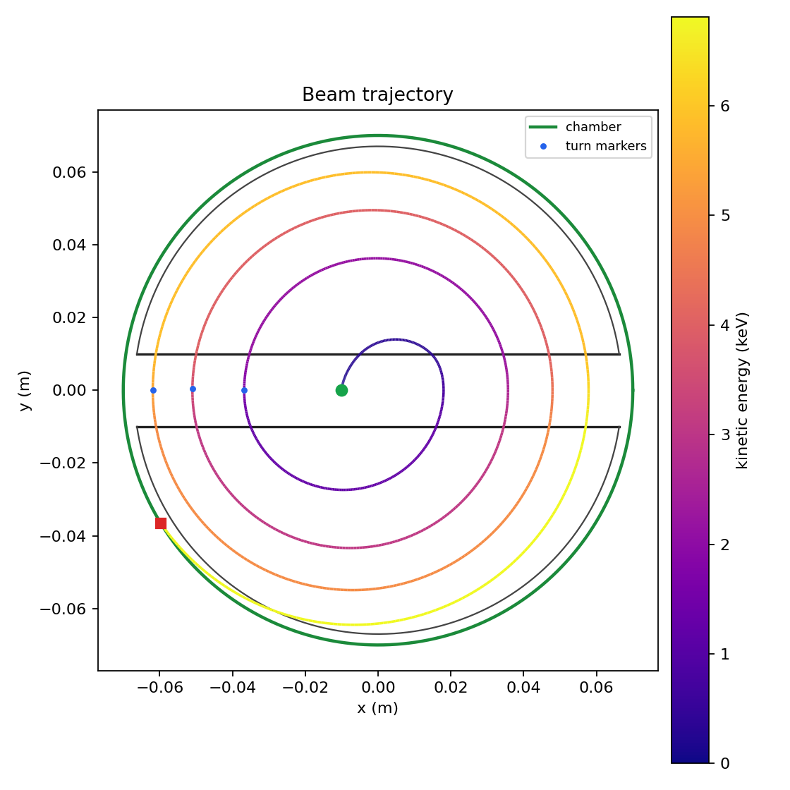
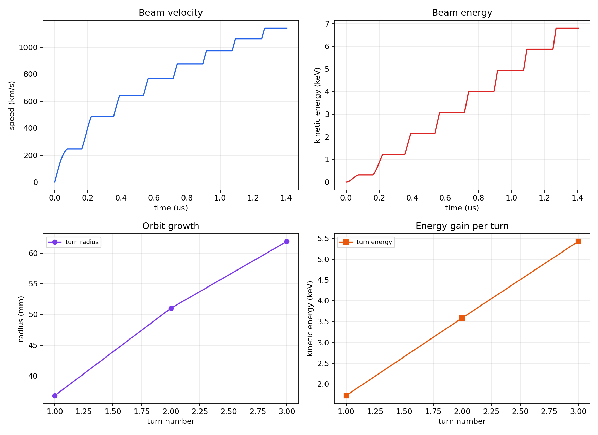
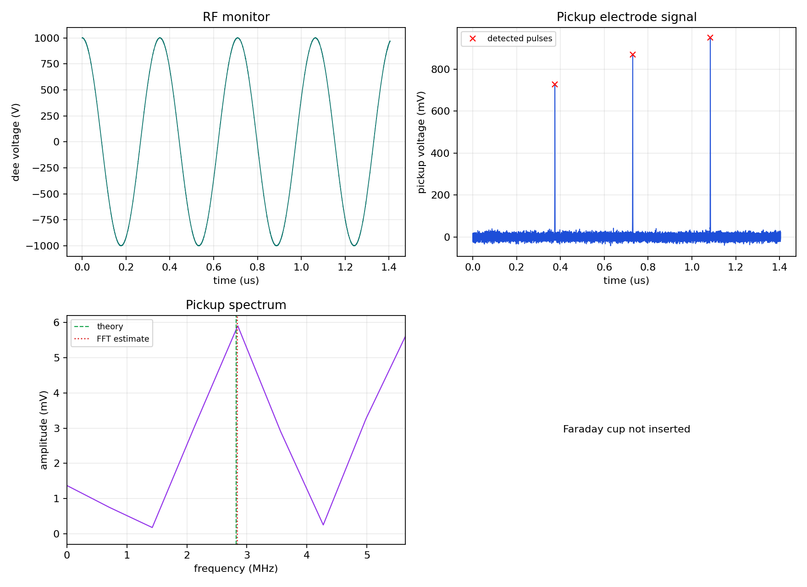

# Cyclotron Beam Dynamics & Instrumentation Simulation

A Python framework for simulating cyclotron beam dynamics and the response of
beam-diagnostic instruments. The project was developed during a master's
internship to connect accelerator physics, numerical simulation and
measurement-instrumentation studies in one reproducible workflow.


## Overview

The simulator tracks a charged particle through a cyclotron-like magnetic field
and an accelerating RF gap. It computes the trajectory, energy gain, turn
structure, extraction point and the signals that a set of diagnostics would
observe. A PyQt6 desktop application provides live parameter updates, an
animated trajectory and measurement readouts. A command-line interface
produces publication-ready plots, CSV tables and an Excel workbook.

The model is deliberately transparent: every detector signal is derived from
the tracked trajectory, and the measurement chain includes finite sampling,
noise, timing jitter and detector resolution. This makes the project suitable
for studying the difference between the simulated beam and the values that an
instrument would actually report.

## Highlights

- Single-particle cyclotron dynamics with non-relativistic and relativistic
  Lorentz equations.
- Sinusoidal or square-wave RF acceleration, adjustable phase, gap width and
  voltage reduction.
- Automatic extraction at the chamber radius or beam stop at a Faraday cup.
- Turn-by-turn energy, radius and crossing-phase analysis.
- Synthetic pickup-electrode signal with time-domain and FFT frequency
  estimation.
- Faraday-cup current, charge and beam-hit detection.
- RF monitor and Bρ-based energy reconstruction.
- PyQt6 GUI with live re-simulation, animated beam motion, zoom/pan and
  parameter export/import.
- CLI for batch runs, plots, CSV files, an Excel workbook and a text report.
- 20 automated unit tests covering the physics, instrumentation and reports.

## Screenshots

| Beam trajectory | Diagnostics |
| --- | --- |
|  |  |



The images are generated by `python run_cyclotron.py` and can be reproduced
from the default operating point.

## Physics model

The magnetic field is along `+z`; the dee gap is parallel to the `x` axis and
the accelerating electric field points along `y` inside `|y| <= d/2`. The
tracked state is `(x, y, vx, vy)` and the equations of motion are

```text
dx/dt  = vx
dy/dt  = vy
dvx/dt =  omega * vy / gamma
dvy/dt =  q * E(t) / (gamma * m) - omega * vx / gamma
```

with `omega = qB/m`, `gamma = 1` in the non-relativistic mode and
`gamma = 1 / sqrt(1 - v^2/c^2)` otherwise. The RF voltage is either
`U0 * sin(2*pi*f*t - phi)` or a square wave with the same phase convention.
The effective gap field is `E = U_eff / d`, where `U_eff` includes the
optional voltage-reduction factor.

The trajectory is integrated with SciPy's `DOP853` solver using
`rtol = 1e-9`, `atol = 1e-11` and a maximum step equal to the configured time
step. An event stops the integration when the particle reaches the chamber
radius; a separate geometric check truncates the trajectory at the Faraday cup.
Turn boundaries and gap crossings are reconstructed from the sampled state.

More detail is available in [docs/PHYSICS.md](docs/PHYSICS.md).

## Instrumentation model

The tracked ion represents a bunch of `beam_particles` ions. The synthetic
measurement chain includes:

- **Pickup electrode** — one Gaussian pulse per revolution, sampled at a
  configurable rate with Gaussian noise and timing jitter. The cyclotron
  frequency is estimated both from peak times and from the FFT of the pickup
  signal.
- **Faraday cup** — a radial beam stop that produces a current pulse when the
  beam reaches the cup radius. The reported charge, peak current and hit count
  are derived from the bunch charge and the detector response.
- **RF monitor** — samples the dee voltage and provides a reference for the
  accelerating phase.
- **Bρ reconstruction** — estimates the beam energy from the measured radius
  and the known magnetic field, including a configurable field uncertainty.

The instrument configuration is independent of the beam simulation, so the
same trajectory can be replayed through different detector settings.

## Repository layout

```text
cyclotron_sim/            Core physics, instrumentation, plotting and reporting
  model.py                Particle, cyclotron configuration, solver, results
  instrumentation.py      Synthetic pickup, Faraday cup, RF monitor, estimates
  plots.py                Chamber geometry and diagnostic figures
  report.py               Text, CSV and Excel reports
cyclotron_gui.py          PyQt6 desktop application
ZykloSim_nov24.ui         Qt Designer interface reused by the GUI
run_cyclotron.py          Command-line entry point
tests/                    Unit tests
docs/images/              Figures used in this README
docs/PHYSICS.md           Model equations, numerical method and validation
legacy/                   Original pre-refactor scripts, kept for reference
```

## Getting started

Requires Python 3.10 or newer.

```bash
python -m venv .venv
# Windows
.venv\Scripts\activate
# Linux / macOS
source .venv/bin/activate

python -m pip install --upgrade pip
pip install -r requirements.txt
```

## Desktop application

```bash
python cyclotron_gui.py
```

The GUI opens maximized and scales its layout to the available screen. It
supports:

- live re-simulation after changing a parameter, slider or checkbox;
- animated, looping beam trajectory with a moving ion marker;
- mouse-wheel zoom at the cursor, toolbar zoom/pan and double-click reset;
- diagram selection (`x-y`, `t-v`, phase portrait, `t-x`, `t-y`);
- configuration load/save as JSON;
- Excel export of the trajectory, turn data, crossings and measurement results.

The interface is built from `ZykloSim_nov24.ui`; the original pyqtgraph
placeholder is replaced at load time by an embedded Matplotlib canvas, so the
project only requires PyQt6 and Matplotlib.

## Command line

Run the default operating point and write all outputs to `results/`:

```bash
python run_cyclotron.py
```

Example with a Faraday cup and a different magnetic field:

```bash
python run_cyclotron.py --b 0.20 --cup --cup-radius-mm 32 --output results_cup
```

Useful options include `--protons`, `--neutrons`, `--charge`, `--f-mhz`,
`--voltage`, `--gap-mm`, `--phase-deg`, `--waveform sine|square`,
`--reduction-pct`, `--x0-mm`, `--y0-mm`, `--vx0`, `--vy0`, `--t-us`,
`--dt-ps`, `--relativistic`, `--cup`, `--cup-radius-mm`, `--beam-particles`,
`--noise` and `--seed`. Run `python run_cyclotron.py --help` for the full list.

The CLI writes:

- `trajectory.png`, `beam_diagnostics.png`, `instrumentation.png`
- `trajectory.csv`, `signals.csv`
- `results.xlsx`
- `report.txt`

## Reference operating point

The default configuration models a proton in a `0.185 T` field with a
`2.82 MHz` RF voltage of `1000 V` and a `20 mm` gap. A representative run
produces:

| Quantity | Value |
| --- | --- |
| Exit condition | extracted at the chamber radius |
| Complete turns | 3 |
| Final energy | 6.8098 keV |
| Final speed | 1142.194 km/s |
| Final radius | 70.000 mm |
| Energy gain per turn | 1.8509 keV |
| Path length | 1.05972 m |
| Gap crossings | 7 |
| Pickup frequency | 2.82047 MHz |
| Theoretical cyclotron frequency | 2.82036 MHz |
| Pickup frequency error | +0.004 % |
| Bρ energy estimate | 6.8338 keV |
| Bρ energy error | +0.352 % |

These values are produced by the default `python run_cyclotron.py` run and are
covered by the automated tests.

## Tests

```bash
python -m unittest discover -s tests -q
```

The suite covers particle definitions, configuration validation, the
non-relativistic and relativistic solvers, extraction and Faraday-cup
behaviour, turn and gap-crossing analysis, pickup-frequency estimation, FFT
and Bρ reconstruction, report formatting and CSV/Excel output.

## Limitations and next steps

The current model tracks a single particle in two transverse dimensions. It
does not include space charge, longitudinal bunch dynamics, fringe fields,
magnet imperfections, RF transients or a full 3D field map. The instrument
signals are synthetic and are intended for method development rather than
calibration of a specific machine.

Natural extensions are multi-particle tracking, a 3D field map, realistic
pickup geometries, RF cavity dynamics and comparison with measured data from a
real cyclotron or a dedicated beam-diagnostics test stand.

## Internship context

This repository is the software part of a master's internship project on
cyclotron beam dynamics and beam instrumentation. The original `ZykloSim`
interface and reference scripts are preserved in `legacy/`; the maintained
implementation is the `cyclotron_sim` package together with the PyQt6 and CLI
front ends.

## Author

**KebedeDesta**  
GitHub: [@KebedeDesta](https://github.com/KebedeDesta)

## License

Released under the MIT License. See [LICENSE](LICENSE).
